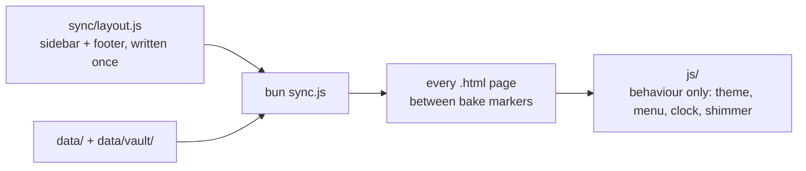

# Lucas' personal website

> My personal website. Plain HTML/CSS/JS, like the aztecs used to do. Check it out at https://lsantos.dev

## Stack

- IBM Plex Mono for all text, self-hosted in `fonts/`, plus a tiny Noto Sans Mono JP subset with only the kana used on /friends (how to rebuild it is in the comment at the top of `css/base.css`)
- Cascadia Mono for code, also in `fonts/`, with no preload, so only pages that show code download it
- HTML, CSS, JS... That's really it. The sidebar and footer every page shares are written once in `sync/layout.js` and baked into each page
- A `sync.js` script that bakes the gear notes (exported from my Obsidian vault into `data/vault`), the `data/*.md` files and the latest blog posts into the HTML, so pages don't fetch anything at runtime

## Editing content

- `data/bio.md` is the about text on the homepage
- `data/now.md` is the /now page, the "last updated" date is the date of the last commit that changed it
- `data/about.md` is the /about page
- `data/ai-usage.md` is the text of the /ai-usage page, linked as "[AI usage policy]" under the theme toggle
- `data/friends.md` is the /friends page
- `data/projects.json` is the software on /projects. Its `status` picks the section: `active` and `in-progress` go under Active, `done`, `inactive` and `archived` under Done, next to the builds
- Vault notes reach the site through `x-personal-site-export-type`, which is `uses`, `build` or a list of both (`[uses, build]`). The second-brain repo exports only the public notes into `data/vault` (private callouts and `%% %%` comments already stripped) and their images into `data/vault/assets`; the sync never reads the Obsidian vault itself. Notes with `private: true` stay off the site
- Gear (`uses`) also needs an `x-personal-site-category`, the /uses section it goes under; `personalRating` is optional, and `updatedAt` shows up on the gear detail page. To list an item under another one (a lens under its camera), add `x-personal-site-parent: "[[Parent Note]]"` to the child; it can also be a list of links
- Builds (`build`) are listed in the builds section of /projects with a `status` badge (`planned`, `in-progress` or `done`; `built` also works and shows as `done`). Gear whose note `type` includes `diy` gets a `diy` tag on /uses. A build that is also gear keeps its page in `gear/`, the others get one in `builds/`
- A gear or build page drops the note's own first `# title`, since the page already shows the note name as its title
- A note's cover is downloaded once, converted to WebP and kept as `img/gear/covers/<slug>.webp`. After changing `coverUrl`, delete that file so the next sync downloads the new one
- `img/gear` is managed by the bake: the CI bake deletes any image there that no note page uses, so don't put images there by hand

After changing any of these, run `bun run sync`. It fetches the latest 3 posts from the blog RSS, generates the note pages in `gear/` and `builds/` (covers and embedded images converted to WebP, with their sizes), and replaces everything between the `<!-- bake:name -->` and `<!-- /bake:name -->` markers in the pages. Anything inside those markers is overwritten on every sync, so edit the template around them, or the `data/` file they come from. It also writes `sitemap.xml`, with a last-modified date for every page except the homepage. `bun run check` then tests the result: every bake marker still closed, the feeds and sitemap well-formed, and every local image a page uses present.

It also writes the RSS feeds, the latest 20 items each: `now.xml` has one item per commit to `data/now.md`, `uses.xml` one per gear note dated by its `updatedAt` (or `createdAt`), `projects.xml` one per project added or changed in the `data/projects.json` history plus the builds, and `feed.xml` merges the three. Blog posts stay in the blog's own feed.

## How pages are built



The rule: HTML shared by several pages lives in `sync/` (`layout.js` for the sidebar and footer, `render.js` for the gear and build pages), a page's own HTML lives in its `.html` file, and nothing inside a pair of bake markers is ever edited by hand.

## Pages and scripts

- Every root page (`index.html`, `about.html`, `now.html`, `friends.html`, `uses.html`, `projects.html`, `ai-usage.html`) is a hand-written template, and the gear and build pages come from the template in `sync/render.js`. All 8 share the same `<head>` block (meta tags, font preload, stylesheets, the two scripts), so a change there goes in all 8 places. `js/theme.js` blocks on purpose; `js/components.js` is deferred
- CSS is split so each page loads only the rules it uses, and editing one page's file can't change another page. `css/base.css` is loaded everywhere: the fonts, the color and size variables, and every rule that two or more pages use. A rule that exactly one page uses goes in that page's file, linked right after `base.css`; a page with no rules of its own has no file. The gear and build pages count as one page (one template):

  | Page | Own CSS file |
  |---|---|
  | `/` | `css/home.css` |
  | `/now` | `css/now.css` |
  | `/uses` | `css/uses.css` |
  | `/projects` | `css/projects.css` |
  | gear and build pages | `css/note.css` |
  | `/about`, `/friends`, `/ai-usage` | none |

  When a second page starts using a rule from a page file, move that rule to `base.css`
- A page with an RSS feed puts its title in `<div class="page-title section-label"><h1>...</h1><a class="feed-icon" ...></a></div>`; a page without one uses a bare `<h1 class="section-label">`
- `js/theme.js` loads first in `<head>`: it applies the saved or system theme before the first paint, picks the day's accent color (one palette per theme, every color readable as link text), and registers the service worker
- The sidebar and footer HTML lives in `sync/layout.js`. Every sync bakes it between `<!-- bake:sidebar -->` and `<!-- bake:footer -->` markers inside `<site-sidebar>` and `<site-footer>` on each root page, with that page's nav link marked active, and the gear and build page template uses the same functions. The two tags are plain wrappers: nothing defines them in JS. The footer year comes from the bake, so it changes on the first bake of a new year (CI bakes daily)
- `js/components.js` loads deferred and only adds behaviour to that baked HTML: the theme buttons' label and clicks, the phone menu button, a random cat before the name (all three are baked, the first one shows without JS), the ASCII avatar shimmer, and the favicon swap to the sleeping cat from midnight to noon, Stockholm time. It never writes HTML
- `js/clock.js` (homepage clock) and `js/gear.js` (the /uses tooltips) only run on their page, deferred. Code that only one page needs gets its own file like these
- `sw.js` keeps a copy of every visited page and file so the site opens offline. It always asks the network first. Every path in its `ASSETS` list must exist, or the worker stops updating
- The homepage has a JSON-LD block that tells search engines who the site belongs to. Its `sameAs` list holds the footer profiles at the address each `*.lsantos.dev` link redirects to, so changing a profile means updating the redirect and that list
- `404.html` is the redirect page for the old short links: any unknown path goes to `go.lsantos.dev`. It is self-contained (font, colors and script inline) and loads none of the files in `css/`

## Hosting

GitHub Pages serves the files committed on `main` as they are; `.nojekyll` turns off Jekyll so nothing else gets published. `robots.txt` keeps `data/` out of search results. The CI workflow (`.github/workflows/build.yml`) runs the sync and the check on every push to `main` that touches the content or the sync code, and once a day for new blog posts, and commits the result.

## Running locally

```sh
bun install
bun run dev         # watch mode plus browser-sync on http://localhost:3456; a data or note change rebakes and reloads, editing sync/ restarts the bake
bun run sync        # bake content into the pages, verbose
bun run sync:quiet  # same, summary lines only
bun run sync:watch  # rebuild on every data or note change
bun run check       # test the baked output
```

`bun sync.js --help` lists every flag:

| Flag | Environment variable | Default |
|---|---|---|
| `--timeout=<ms>` | `FETCH_TIMEOUT_MS` | `15000` |
| `--debug` | `DEBUG=sync:*` | off |
| `--prune-images` | | off, only the CI bake passes it |

Verbose output goes through the `debug` package on stderr, split into `sync:vault`, `sync:covers`, `sync:gear` and `sync:bake`, so `DEBUG=sync:covers bun sync.js` narrows it to one stage.

## License

MIT
